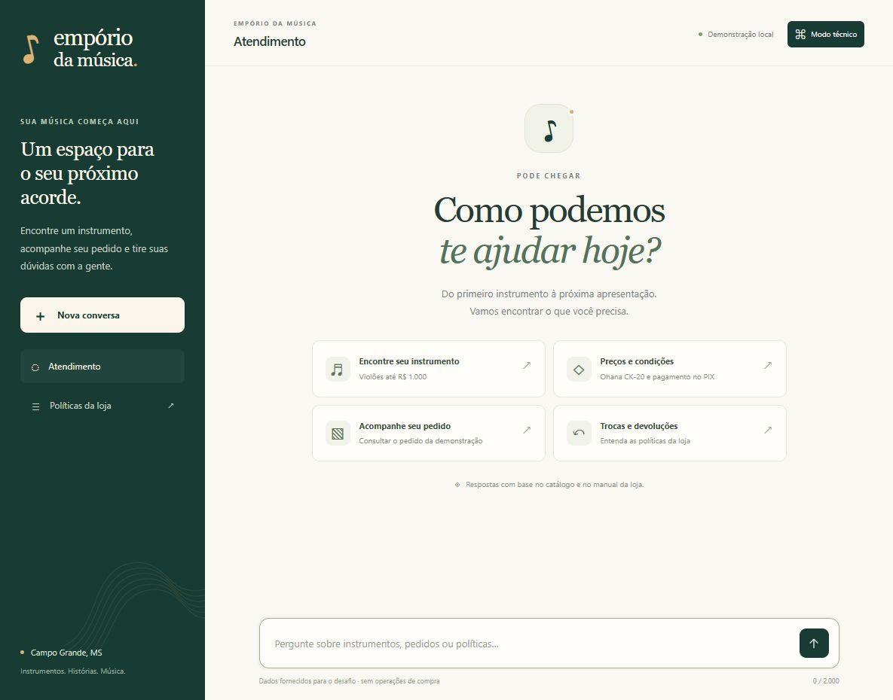
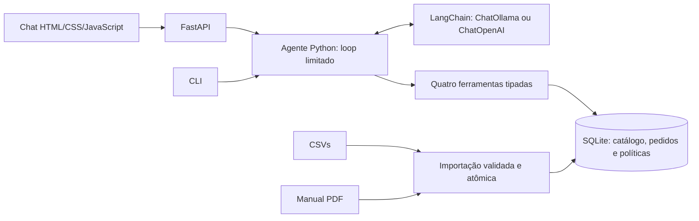

# Empório da Música — agente de atendimento

Protótipo em Python para o desafio de AI Engineer Júnior da Artefact. O assistente consulta catálogo, promoções, pedidos e políticas da loja fictícia antes de responder. Há um chat web, uma API e uma CLI sobre o mesmo núcleo.

O modelo local inicial é **Qwen 3 14B pelo Ollama**, já disponível no ambiente de desenvolvimento. LangChain integra os modelos e as ferramentas. É possível selecionar Llama local ou uma alternativa OpenAI pelo `.env`, sem mudar as regras de negócio.



## Obter o código

```powershell
git clone https://github.com/RaFaSMK/artefact-ai-engineer-challenge.git
cd artefact-ai-engineer-challenge
```

## Executar no Windows

Pré-requisitos: **Python 3.12** (versão usada na validação), Git e [Ollama](https://ollama.com/download). O projeto requer Python 3.12 ou superior, mas outras versões não foram verificadas nesta entrega. Execute os comandos abaixo na raiz do repositório.

```powershell
py -3.12 -m venv .venv
.\.venv\Scripts\python.exe -m pip install -r requirements-lock.txt
.\.venv\Scripts\python.exe -m pip install -e . --no-deps
Copy-Item .env.example .env
ollama pull qwen3:14b
.\.venv\Scripts\python.exe -m emporio ingest
.\.venv\Scripts\python.exe -m emporio serve --port 8765
```

Abra [o chat local](http://127.0.0.1:8765/). O servidor se limita a `127.0.0.1`. A documentação da API fica em [Swagger](http://127.0.0.1:8765/docs), cuja interface padrão usa assets de CDN. O [esquema OpenAPI](http://127.0.0.1:8765/openapi.json) e o chat usam o servidor local.

No computador em que este projeto foi preparado, `.venv`, `.env` e o modelo já foram configurados. Para iniciar novamente, basta:

```powershell
.\.venv\Scripts\python.exe -m emporio serve --port 8765
```

Se Python 3.12 não estiver instalado, instale-o antes de criar o ambiente. Não é necessário ativar o ambiente virtual nem mudar a política de execução do PowerShell: os comandos usam o executável diretamente. O download do modelo pode ocupar vários GB; RAM, VRAM, aceleração e contexto afetam o desempenho.

Para macOS/Linux com Python 3.12: use `python3.12 -m venv .venv` e substitua `.\.venv\Scripts\python.exe` por `.venv/bin/python`; copie o ambiente com `cp .env.example .env`. Esses sistemas não foram testados nesta preparação.

Se o Ollama não estiver aberto, inicie o aplicativo ou execute `ollama serve` em outro terminal. `ollama list` mostra os modelos instalados. A aplicação não baixa modelos nem usa nuvem automaticamente.

## Trocar de modelo pelo ambiente

O `.env` é lido quando o processo começa. Reinicie o servidor ou a CLI depois de alterar a configuração. Variáveis já exportadas no terminal têm precedência sobre o arquivo.

Local, com o modelo já validado:

```dotenv
LLM_PROVIDER=ollama
LLM_MODEL=qwen3:14b
LLM_BASE_URL=http://localhost:11434
LLM_API_KEY=
```

Para Llama, primeiro execute `ollama pull llama3.1:8b` e altere apenas `LLM_MODEL=llama3.1:8b`. A integração local é nativa via `ChatOllama`, por isso o endereço não contém `/v1`. Llama não foi incluído na avaliação de comportamento desta versão.

Alternativa remota:

```dotenv
LLM_PROVIDER=openai
LLM_MODEL=gpt-5.4-mini
LLM_BASE_URL=https://api.openai.com/v1
LLM_API_KEY=sua-chave-no-ambiente-local
```

`llm.py` instancia `ChatOllama` ou `ChatOpenAI`. A factory remota foi testada sem acesso à rede; a execução real com OpenAI depende de conta, chave e acesso ao modelo e **não foi validada**. Parâmetros e qualidade não são universais: uma nova combinação precisa repetir os cenários de avaliação. Não há fallback automático entre provedores.

Outras opções estão em `.env.example`: timeout, limite de chamadas, tamanho de contexto, reasoning local, cliente fictício, retenção da sessão e modo técnico. A chave fica no backend e não é enviada ao navegador. `.env`, banco local, logs e ambiente virtual estão ignorados no Git.

## Usar a CLI e executar testes

```powershell
.\.venv\Scripts\python.exe -m emporio chat
.\.venv\Scripts\python.exe -m pytest -q
```

Na CLI, `/nova` limpa o histórico e `/sair` encerra. A memória fica apenas no processo. O chat web oferece uma ação de nova conversa e impede mensagens simultâneas na mesma conversa.

Para gerar novamente as conversas reais e o relatório com o modelo configurado:

```powershell
.\.venv\Scripts\python.exe scripts/evaluate.py
```

O script faz inferências reais e substitui os cinco exemplos e o relatório em `examples/`. O registro JSON auxiliar fica em `runtime/`, fora do Git. Confira os resultados e revise as respostas antes de usá-las como evidência. Não execute nem altere o repositório após o prazo de entrega do processo seletivo.

## Arquitetura e decisões



| Decisão | Justificativa |
| --- | --- |
| LangChain para modelos, mensagens e ferramentas | Reaproveitar integrações e tipos comuns em vez de manter tradução própria de protocolos |
| Loop explícito, até quatro chamadas ao modelo por mensagem | Fluxo curto e fácil de inspecionar, com execução restrita às ferramentas registradas |
| SQLite e consultas escritas pela aplicação | Filtros exatos, relações e controle por cliente sem servidor de banco ou SQL livre para o modelo |
| Busca de políticas por seção e FTS5 | Manual pequeno de oito páginas; manter regras e exceções juntas e preservar a página de origem |
| Regras de preço em Python | `Decimal`, centavos e arredondamento definido; valores não dependem de cálculo do LLM |
| Uma página JavaScript servida pelo FastAPI | Mostrar o fluxo completo com Python como linguagem principal e sem compilação de frontend |
| Histórico local em memória | Continuidade de conversa sem adicionar persistência e retenção de dados |

### Ferramentas

| Ferramenta | Responsabilidade |
| --- | --- |
| `search_products` | Nome/categoria, orçamento sobre preço final, estoque e promoções; até cinco resultados |
| `get_product` | Detalhe por ID e recálculo da condição de pagamento |
| `get_order_status` | Status, valor histórico, rastreio e previsão do cliente da demonstração |
| `search_policies` | Até três seções do manual, com exceções, notas de ambiguidade e página |

As ferramentas são vinculadas com `bind_tools`. O loop preserva `AIMessage` e associa resultados `ToolMessage` aos IDs correspondentes. Os argumentos passam por schemas Pydantic fechados. O modelo não escolhe a identidade do cliente nem executa SQL livre. Erros do provedor não expõem respostas brutas, credenciais ou prompts no navegador.

### Recuperação e prompt

O manual é extraído por página e segmentado em 28 seções conhecidas. Um mapa pequeno de assuntos/sinônimos recupera regras complementares, como promoções + PIX e as duas referências divergentes de WhatsApp. Perguntas sem correspondência nesse mapa usam FTS5 com tokens sanitizados; há fallback textual quando a extensão não existe. O corpus e o mapa são específicos do material recebido.

A persona é informal e profissional. O prompt exige consulta antes de fatos operacionais, orienta esclarecimento de dados ausentes e delimita o escopo da loja. A recusa de acessórios pode usar o escopo já definido na persona, sem consultar um preço inexistente. O executor limita chamadas, rejeita funções desconhecidas e valida argumentos. Uma checagem adicional rejeita valores explícitos em reais que não aparecem na consulta ou na mensagem do cliente; isso é uma proteção parcial e não uma garantia semântica de toda resposta. Quando o modelo menciona preço promocional sem o original, a aplicação completa a informação a partir do mesmo resultado consultado. Para a lacuna conhecida do frete de exatamente R$ 500, a aplicação responde com um pedido de confirmação somente depois de recuperar a seção correspondente.

Em continuações, o backend guarda o último ID de produto identificado sem ambiguidade e limpa essa referência quando a busca traz várias opções. Esse ID ajuda o modelo a resolver “e no PIX?”, mas uma nova consulta é exigida antes de repetir preços. Notas internas de correção não são guardadas como falas do cliente no histórico permanente da sessão.

`responses.py` aplica um polimento limitado antes da entrega da resposta: remove ofertas de ações sem integração, substitui afirmações indevidas de execução por uma descrição das capacidades e corrige expressões de atendimento em inglês observadas nos testes. Os fatos e valores sustentados pelas fontes são preservados. O mesmo texto entregue é salvo no histórico. Essa camada não é um detector geral de idioma nem substitui a avaliação do modelo.

As fontes são montadas pelo código a partir dos resultados consultados. O modo técnico opcional exibe somente nomes de ferramentas, status, duração e uso reportado, sem argumentos brutos ou dados de clientes. Não representa raciocínio interno do modelo.

## Dados e suposições

A base recebida contém 65 produtos, nove categorias, 25 promoções (quatro ativas), 20 pedidos, 22 itens e 50 clientes. A importação valida tipos, relações, descontos, status e especificações JSON. Ela cria um banco temporário e só substitui o anterior após sucesso. Reexecutar `ingest` reconstrói o snapshot sem duplicar registros; arquivos originais são preservados.

O banco derivado importa somente o ID de clientes e exclui contatos e observações internas de pedidos. Os CSVs originais são os materiais fornecidos para a loja fictícia do desafio.

Decisões importantes:

- Disponível para oferta significa `active` e estoque positivo. Produtos descontinuados ou `coming_soon` não são oferecidos, mesmo se houver quantidade registrada. Uma busca nominal pode identificar um produto indisponível e explicar seu status.
- Busca por nome tolera pontuação. Se nome e categoria divergirem, recupera o candidato e pede esclarecimento em vez de declarar ausência em toda a base.
- Apenas promoções com `is_active=1` são aplicadas. O snapshot não possui datas de validade. Duas promoções ativas no mesmo produto geram conflito.
- Promoção ativa não acumula com 5% de PIX. Sem forma de pagamento informada, usamos promoção ativa ou tabela. Cálculos arredondam a centavos com `ROUND_HALF_UP`.
- O total histórico de pedidos é preservado. Pedidos 3 e 20 diferem da soma dos preços atuais, e a base não informa os motivos nem os preços praticados na compra.
- Previsão de entrega é a registrada no snapshot. A data atual é interpretada no fuso `America/Campo_Grande`. Não existe consulta à transportadora nem nova estimativa calculada.
- Devolução exige informações que não existem na tabela, como data efetiva de recebimento e canal da compra. O agente orienta e pede informações, sem aprovar ou executar devolução.
- Parcelamento: a seção 3.1 detalha 4–6x e 7–12x e é priorizada em relação à tabela geral. A ressalva de R$ 50 para até 3x exige confirmação.
- Frete de exatamente R$ 500 é uma lacuna do manual. O agente deve pedir confirmação. Frete externo não é cotado sem peso, dimensões e integração.
- Telefones de WhatsApp e grafias de e-mail divergem no documento. A seção específica de WhatsApp é uma referência a explicar com ressalva, sem apresentar o contato como confirmado.

## Pedidos e sessões: limite da demonstração

`DEMO_CUSTOMER_ID=2` fixa no backend o cliente fictício da demonstração. O pedido 8 pertence a esse contexto. O modelo informa somente `order_id`; o repositório aplica o filtro de cliente. Pedido inexistente e pedido de outra pessoa geram a mesma resposta genérica.

IDs opacos separam históricos de conversas. Eles não autenticam pessoas. As sessões expiram e têm limite de quantidade e de turnos. Este é um protótipo local, com um processo de servidor e um cliente configurado; uma aplicação pública precisaria de autenticação e autorização reais, armazenamento compartilhado de sessões e revisão da política de dados.

## Exemplos e avaliação

- [Catálogo e continuação](examples/01_catalogo.md)
- [Promoção sem acúmulo de PIX](examples/02_promocao_pix.md)
- [Pedido e previsão antiga](examples/03_pedido.md)
- [Políticas e dados ausentes](examples/04_politicas.md)
- [Escopo e acesso a pedidos](examples/05_limites.md)
- [Relatório de avaliação real](examples/avaliacao.md)

Os testes determinísticos verificam regras monetárias, disponibilidade, integridade da importação, recuperação de políticas, acesso a pedidos, configuração de provedores, sessões, contratos HTTP e comportamento controlado do loop. Eles simulam somente o modelo/rede. O relatório separado registra as conversas com o Qwen real e critérios explícitos de ferramenta, fonte e conteúdo. Uma bateria pequena não comprova qualidade geral.

## Limitações e próximos passos

- Snapshot estático, sem integração com estoque, transportadora, cadastro atual ou calendário de feriados.
- Sem vendas, reservas, registro de reclamação, cancelamentos, devoluções ou alterações de pedido.
- Sem autenticação de produção, persistência de histórico, múltiplos processos ou deploy público.
- Busca textual e regras de extração adaptadas ao manual recebido. Uma nova versão precisa de reimportação, revisão e testes; embeddings seriam avaliados se paráfrases falharem nos testes.
- LangChain padroniza a integração, mas modelos ainda podem escolher argumentos inadequados ou responder mal. O projeto tem validações e evidências específicas, sem garantia de ausência de alucinações.
- O polimento cobre padrões conhecidos de ofertas sem integração e mistura de idioma, com testes de preservação de preços, negativas e termos de catálogo. Não cobre todas as formas possíveis de redação. A bateria automática verifica critérios delimitados e não mede todo o tom ou todas as sugestões do modelo.
- Chat retorna JSON completo, com carregamento. Streaming de tokens, métricas operacionais persistentes e maior cobertura de avaliação são evoluções.
- Qwen 3 14B foi o modelo usado na avaliação. Llama e execução remota precisam de avaliação real própria.

## Uso de assistente de código e aprendizado

Usei Codex para analisar os PDFs e CSVs, preparar o planejamento, implementar o protótipo, executar testes e produzir os exemplos por chamadas reais ao modelo local. As decisões e verificações estão documentadas para revisão pelo candidato; o uso da ferramenta não substitui estudar o código e conferir as respostas.

O [planejamento](PLANEJAMENTO.md) registra o diagnóstico e o escopo. O [guia de estudo](GUIA_ESTUDO_ENTREVISTA.md) explica decisões, fluxo de execução e roteiro de apresentação. O registro de execução ao final do guia distingue o que já foi verificado das limitações restantes.

Referências técnicas: [ChatOllama](https://docs.langchain.com/oss/python/integrations/chat/ollama), [ChatOpenAI](https://docs.langchain.com/oss/python/integrations/chat/openai), [mensagens LangChain](https://docs.langchain.com/oss/python/langchain/messages), [SQLite](https://docs.python.org/3/library/sqlite3.html), [FTS5](https://www.sqlite.org/fts5.html), [FastAPI](https://fastapi.tiangolo.com/tutorial/).
